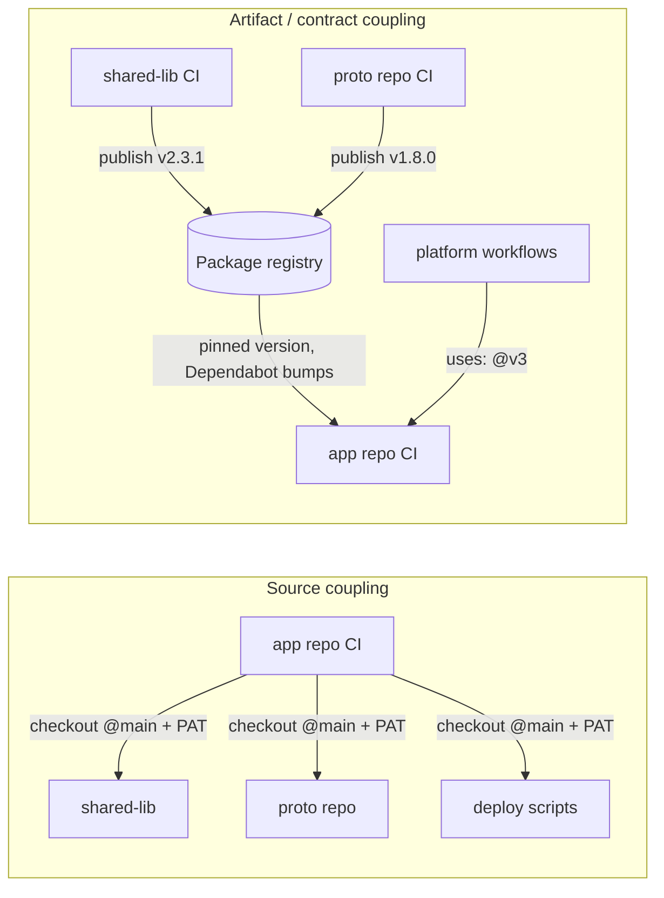

Almost every enterprise CI conversation I have starts with the same question: "my build needs code from another repo, how do I get access to it?"

That's the wrong question. And answering it is how you end up with an org-wide PAT checking out 14 repos at `main` on every build.

<!--truncate-->

The better question is **what does that repo publish?** And right behind it, **who runs whose tests?** Answer those two and the rest of your pipeline design mostly falls out.

## The Default Everyone Builds

It usually looks like this:

```yaml
- uses: actions/checkout@v7
  with:
    repository: acme/shared-lib
    ref: main
    token: ${{ secrets.ORG_WIDE_PAT }}
    path: shared-lib
```

Multiply by however many repos your build "needs." What you've actually built:

- **Source coupling.** Your build depends on whatever happens to be on someone else's `main` right now. They merge, you break, and nobody on their team ever sees the red.
- **A non-reproducible build.** Rerun yesterday's job and you get different code. Good luck bisecting.
- **A long-lived secret with way too much reach.** That PAT is tied to a person (or a "bot" account someone shares), can usually read far more than this one build needs, and lives forever. Exactly the kind of credential that [shows up in supply chain incidents](/blog/beyond-the-oidc-silver-bullet).

None of this is specific to GitHub Actions. You'd build the same mess in Jenkins.

## Couple to Artifacts and Contracts



In the source-coupled model, every repo is part of every other repo's build. With artifact coupling, each repo has one job: build, test, publish a versioned thing. Consumers pin a version. Upgrades are PRs you can review and revert.

Honestly this is also why monorepo vs polyrepo is mostly the wrong argument. Big monorepos work because everything builds and tests together at one commit. Polyrepos work when repos talk through versioned contracts. What doesn't work is polyrepos pretending to be a monorepo by cloning each other at `main`. You get the costs of both and the benefits of neither.

## 1. Consume Artifacts, Not Source

If another team's code is something you build against, it should be a package. npm, Maven, NuGet, a container image, whatever fits. [GitHub Packages](https://docs.github.com/en/packages/learn-github-packages/introduction-to-github-packages) and the [Container registry](https://docs.github.com/en/packages/working-with-a-github-packages-registry/working-with-the-container-registry) handle this fine, and the producer's workflow can push with `GITHUB_TOKEN` and `packages: write`. Consumers read with `GITHUB_TOKEN` too, once you [grant their repos access to the package](https://docs.github.com/en/packages/learn-github-packages/configuring-a-packages-access-control-and-visibility#ensuring-workflow-access-to-your-package). No extra credentials.

Consumers pin an exact version and let [Dependabot](https://docs.github.com/en/code-security/dependabot/dependabot-version-updates/about-dependabot-version-updates) open the bump PRs. Point it at your [private registries](https://docs.github.com/en/code-security/dependabot/working-with-dependabot/configuring-access-to-private-registries-for-dependabot) and [group the updates](https://docs.github.com/en/code-security/dependabot/dependabot-version-updates/optimizing-pr-creation-version-updates#grouping-dependabot-updates-into-one-pull-request) so you don't drown in them. Now every upgrade runs your full CI before it lands, which is the whole point.

Sometimes you do need source (codegen, a vendored tool, whatever). Fine. Pin it to a full commit SHA, and if it matters enough, vendor it into your repo. Large monorepos do exactly this with third-party code for a reason. Never float on `main`.

## 2. Auth Without PATs

Once you're consuming artifacts, most cross-repo access disappears. For what's left, stop minting PATs.

- **Sharing actions and reusable workflows** doesn't need a token at all. Turn on access for [private repos](https://docs.github.com/en/actions/creating-actions/sharing-actions-and-workflows-from-your-private-repository) or [internal repos across your enterprise](https://docs.github.com/en/actions/creating-actions/sharing-actions-and-workflows-with-your-enterprise) in the repo's Actions settings.
- **Cloud credentials** go through [OIDC](https://docs.github.com/en/actions/security-for-github-actions/security-hardening-your-deployments/about-security-hardening-with-openid-connect). No stored keys.
- **Actual cross-repo API calls** use a [GitHub App installation token](https://docs.github.com/en/apps/creating-github-apps/authenticating-with-a-github-app/authenticating-as-a-github-app-installation), scoped to the exact repos and permissions the job needs:

```yaml
- uses: actions/create-github-app-token@v3
  id: app-token
  with:
    client-id: ${{ vars.CI_APP_CLIENT_ID }}
    private-key: ${{ secrets.CI_APP_PRIVATE_KEY }}
    owner: ${{ github.repository_owner }}
    repositories: shared-proto
    permission-contents: read
```

Yes, the private key is still a secret. But it isn't tied to a human, it can only mint tokens that expire in an hour, and every token is scoped to what you wrote down in the workflow. That's a much smaller blast radius than a PAT someone made in 2021 with `repo` scope.

## 3. Platform Owns the Pipeline

If 400 repos each hand-roll their own build, every pipeline fix is 400 PRs.

Put the golden path in a central repo as [reusable workflows](https://docs.github.com/en/actions/using-workflows/reusing-workflows). App repos call it with inputs and stay tiny:

```yaml
name: CI
on:
  pull_request:
  merge_group:

permissions:
  contents: read
  packages: write
  id-token: write

jobs:
  ci:
    uses: acme/platform-workflows/.github/workflows/node-service.yml@v3
    with:
      node-version: 24
```

The platform team versions it, ships improvements once, and every repo gets them on the next bump. For the stuff that isn't optional (security scans, provenance, policy checks), enforce it with [org-level ruleset workflows](https://docs.github.com/en/enterprise-cloud@latest/repositories/configuring-branches-and-merges-in-your-repository/managing-rulesets/available-rules-for-rulesets#require-workflows-to-pass-before-merging) so it runs whether the app repo calls it or not.

## 4. Flip Integration Testing Around

This is the one that changes the most, and the one almost nobody does.

The default: the consumer clones its dependencies and runs integration tests. So when `shared-lib` merges a breaking change, the failure shows up later, in somebody else's repo, owned by somebody who didn't make the change.

Flip it. **The dependency triggers the consumer's tests.** When a PR opens on `shared-lib`, it publishes a preview version (say `2.4.0-pr.123`) and kicks off each known consumer's test suite with [`workflow_dispatch`](https://docs.github.com/en/actions/using-workflows/events-that-trigger-workflows#workflow_dispatch) or [`repository_dispatch`](https://docs.github.com/en/actions/using-workflows/events-that-trigger-workflows#repository_dispatch). The consumer runs its tests against that preview, then reports back by creating a [check run](https://docs.github.com/en/rest/checks/runs) on the producer's PR.

The producer side is one step with an App token that has `permission-actions: write` on the consumer:

```bash
gh workflow run contract-tests.yml -R acme/checkout-service \
  -f producer-repo=acme/shared-lib \
  -f producer-sha="$PR_HEAD_SHA" \
  -f version=2.4.0-pr.123
```

The consumer side:

```yaml
name: Contract tests
on:
  workflow_dispatch:
    inputs:
      producer-repo:
        required: true
      producer-sha:
        required: true
      version:
        required: true

permissions:
  contents: read
  packages: read

jobs:
  test:
    runs-on: ubuntu-latest
    steps:
      - uses: actions/checkout@v7
      - uses: actions/setup-node@v7
        with:
          node-version: 24
          registry-url: https://npm.pkg.github.com
      - run: npm ci
      - run: npm install "@acme/shared-lib@$VERSION"
        env:
          VERSION: ${{ inputs.version }}
          NODE_AUTH_TOKEN: ${{ secrets.GITHUB_TOKEN }}
      - run: npm test

      - uses: actions/create-github-app-token@v3
        if: ${{ !cancelled() }}
        id: app-token
        with:
          client-id: ${{ vars.CI_APP_CLIENT_ID }}
          private-key: ${{ secrets.CI_APP_PRIVATE_KEY }}
          owner: ${{ github.repository_owner }}
          repositories: shared-lib
          permission-checks: write
      - if: ${{ !cancelled() }}
        env:
          GH_TOKEN: ${{ steps.app-token.outputs.token }}
          PRODUCER_REPO: ${{ inputs.producer-repo }}
          PRODUCER_SHA: ${{ inputs.producer-sha }}
          CONCLUSION: ${{ job.status == 'success' && 'success' || 'failure' }}
        run: |
          gh api "repos/$PRODUCER_REPO/check-runs" \
            -f name="consumer / $GITHUB_REPOSITORY" \
            -f head_sha="$PRODUCER_SHA" \
            -f status=completed \
            -f conclusion="$CONCLUSION" \
            -f details_url="$GITHUB_SERVER_URL/$GITHUB_REPOSITORY/actions/runs/$GITHUB_RUN_ID"
```

Why an App and not `GITHUB_TOKEN`? `GITHUB_TOKEN` is scoped to the repo it runs in, and [write access to checks is only available to GitHub Apps](https://docs.github.com/en/rest/checks/runs#create-a-check-run). Bonus: make that check [required on the producer and set your App as the expected source](https://docs.github.com/en/repositories/configuring-branches-and-merges-in-your-repository/managing-rulesets/available-rules-for-rulesets#require-status-checks-to-pass-before-merging), so nobody can fake it with a random status.

Now the breaking change goes red **on the PR that introduced it**, in front of the person who wrote it, before it merges. That's the entire value of integration testing, delivered to the right person.

## 5. Make the Feedback Loop Fast

All of this only works if CI is fast enough that people don't route around it.

- **[Merge queue](https://docs.github.com/en/repositories/configuring-branches-and-merges-in-your-repository/configuring-pull-request-merges/managing-a-merge-queue).** Add the [`merge_group`](https://docs.github.com/en/actions/using-workflows/events-that-trigger-workflows#merge_group) trigger and let the queue test PRs together against the real tip of `main`. GitHub runs its own large monorepo on it: [over 500 engineers merge 2,500 PRs a month](https://github.blog/engineering/engineering-principles/how-github-uses-merge-queue-to-ship-hundreds-of-changes-every-day/) through merge queue, with a 33% drop in average time to ship.
- **Don't redo green work.** [Path filters](https://docs.github.com/en/actions/using-workflows/workflow-syntax-for-github-actions#onpushpull_requestpull_request_targetpathspaths-ignore), [caching](https://docs.github.com/en/actions/using-workflows/caching-dependencies-to-speed-up-workflows), and build tools that know what changed. If nothing in a service changed, don't test it again.
- **Bigger machines.** [Larger GitHub-hosted runners](https://docs.github.com/en/actions/using-github-hosted-runners/about-larger-runners) are a `runs-on` change. Your engineers waiting 20 minutes on a 2-core box costs way more than the compute.

## Microservices: Same Idea, Runtime Edition

Microservices make this more obvious, not less. Services talk to each other at **runtime**, over the network. There's no reason one service's build should touch another service's source. Each one should build, test, and deploy on its own.

What they share is a contract, so treat the contract like the artifact:

- **Publish API contracts as packages.** Protobuf or OpenAPI specs, versioned and pinned like any other dependency.
- **Break the build in the producer's PR.** [`buf breaking`](https://buf.build/docs/breaking/) for protobuf, or consumer-driven contracts with [Pact](https://docs.pact.io/), so removing a field fails CI on the service that removed it.
- **Change schemas in two steps.** [Expand, migrate, contract](https://martinfowler.com/bliki/ParallelChange.html). Add the new field, move consumers over, then remove the old one.
- **Decouple deploy from release.** Ship dark behind [feature flags](https://martinfowler.com/articles/feature-toggles.html) so deploying a service doesn't mean every other service has to be ready.
- **Ephemeral environments for E2E smoke.** Spin up a real environment per PR or per merge group for a handful of end-to-end checks, gated with [environments](https://docs.github.com/en/actions/deployment/targeting-different-environments/using-environments-for-deployment). Not on every push, and not as your main line of defense.

And the honest diagnosis. If service A can't ship unless B and C ship with it, that's a distributed monolith. A monolith with network hops in the middle. Either fix the contracts so they can ship independently, or put them in one repo and build them together. Separate repos only pay for themselves if the things in them actually deploy separately.

## Start Here

Pick your worst build, the one with the most `repository:` lines in a checkout step. For each one, ask what that repo should be publishing instead. That list is your migration plan.
